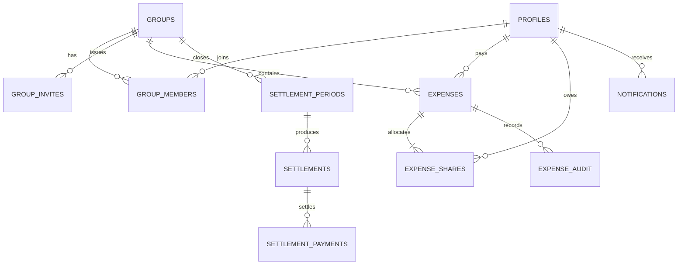

# Chai Khapa — V1.0 Technical Blueprint

**Document status:** Implementation blueprint (draft, ready for engineering review)  
**Prepared:** 30 October 2026  
**Revised:** 31 October 2026 — UX, WhatsApp sharing, settlement rounding, backups, OAuth and monitoring  
**Launch goal:** An initial, usable PWA before Monday, 2 November 2026  
**Budget constraint:** Rs. 0 recurring cost while within free-tier limits  
**Time zone:** `Asia/Karachi` for group accounting  
**Primary currency:** PKR, persisted as integer **paisa**

> **Product promise:** Record a shared chai bill in seconds; recover expenses without arguments. V1.0 is **not** a fairness score or recommended-next-payer system.

## 1. Scope and release boundaries

### 1.1 First usable deployment (the Monday recording milestone)

- Google Sign-In using a project-owned Google Cloud OAuth configuration and Supabase Auth.
- First name and last name stored separately; email from verified Google identity.
- Create one or more groups; join a group by an invitation link.
- A group may have any practical number of members; a session selects only the attendees.
- Record a session with **amount first**, date/time, participants, and the authenticated payer.
- Prefill selected attendees using the most recent active session **in the same group**, excluding people who are no longer active members and ensuring the logged-in payer remains selected; user can freely toggle the list.
- Equal splitting in whole paisa with a deterministic remainder rule.
- View group session history, current per-member contributions and net balances.
- Complete **in-app** notification inbox: persistent, unread count, mark read, mark all read, pagination, deep links, access checks, and live updates while open.
- Installable responsive PWA and free-tier deployment.
- Basic correction flow with audit record while an accounting period is still open.

### 1.2 Follow-up releases, without changing the core ledger

- **V1.0.1, ASAP:** Browser Web Push (VAPID, service worker, subscriptions, retry and delivery logs).
- **Before first month-end settlement:** Monthly closing, creditor/debtor netting, payment claims, recipient confirmation, pending balances, **WhatsApp prefilled share-summary link**, optional Raast/mobile wallet details, and email summaries when feasible.
- **Later:** Custom splits, IBAN/bank accounts, partial settlement payments, advanced group roles and reminders.

**Not in the first release:** Fairness scores, recommended next payer, automated bank transfers, actual payment processing, custom itemized bills, and mandatory bank/wallet information.

## 2. Technology and infrastructure

| Layer | Selection | Reason |
|---|---|---|
| Frontend | React + TypeScript + Vite | Static, simple, rapid deployment |
| UI | Tailwind CSS + accessible primitives | Mobile-first and consistent |
| Router | React Router | Client-side authenticated routes |
| PWA | `vite-plugin-pwa` / Workbox | Installability and future push support |
| Identity | Supabase Auth + Google OAuth | Unique identities, no password-management work initially |
| Data | Supabase Postgres | Transactional financial records |
| Authorization | PostgreSQL Row Level Security (RLS) | Enforce group isolation in database |
| Mutations | Carefully restricted Postgres RPC functions | Atomic, server-authoritative financial changes |
| Live notifications | Supabase Realtime, with DB query fallback | Fast inbox updates; DB remains source of truth |
| Static hosting | Cloudflare Pages | Free-tier deployment with `pages.dev` subdomain |
| Source control | GitHub private repository | Versioning and CI integration |
| Scheduled work | Database cron / scheduled functions when enabled | Period closing and notification jobs |

**Free-tier caveats:** All providers impose changing usage/quotas. Verify current terms during setup. Supabase Free can pause projects with insufficient user database activity, **even if a scheduled health check is running**; there is no supported zero-cost uptime guarantee. Managed automatic backups are not included on Supabase Free, so implement scheduled encrypted logical dumps to an independent, access-controlled destination and perform restoration drills. GitHub Actions schedules may be delayed or skipped; public-repo schedules are disabled after 60 days without repository activity. Email sending and a custom domain are not dependencies for the first deployment.

**Google OAuth ownership:** Use a dedicated project-controlled Google account/project rather than tying production credentials to an unrelated personal Google Cloud project. Set the OAuth app to External/Production and request only the basic identity scopes `openid`, `email`, `profile` (including equivalent userinfo scopes). These avoid sensitive/restricted-scope review, **but branding verification may still be required to display Chai Khapa's name/logo**; leaving the logo blank does not guarantee no review, and an unverified production app may instead show the Supabase project identity. Verify Google's current published-state requirements and test the real production login before inviting colleagues.

### 2.1 Request flow

1. Browser signs in via Google -> Supabase Auth session.
2. Client sends an authenticated call to a database RPC to record the bill.
3. RPC checks the caller, group membership, active payer, participant list, date and amount.
4. In one transaction, RPC saves expense + shares + audit event + recipient notifications.
5. Client reads balances using a restricted group aggregate view/RPC.
6. Notification inbox uses database reads and optional Realtime subscriptions. Later, the same notification records trigger Web Push/email delivery attempts.

## 3. Core accounting and data rules

1. **Money:** Persist all PKR values as `bigint` integer **paisa**. Never use JavaScript binary floating-point arithmetic to allocate shares. Parse rupee input as a decimal string, e.g., `"99.50"` -> `9950`.
2. **Equal shares:** `base = floor(total_paisa / participant_count)`; `remainder = total_paisa % participant_count`. Each attendee gets `base` and the first `remainder` attendees in a stable UUID sort receive 1 additional paisa. This preserves `SUM(shares) = total`.
3. **Example:** Rs. 100 among 3 = 10,000 paisa -> 3,334 + 3,333 + 3,333 (Rs. 33.34, Rs. 33.33, Rs. 33.33).
4. **Attendance:** Group size and per-session attendance are unrelated. For launch, the payer must be among the selected participants, and the authenticated creator is the payer; the schema should not require those constraints forever.
5. **Balance:** For each person in a group/period: `net_paisa = SUM(expenses paid) - SUM(expense shares owed)`. Positive means the group owes them; negative means they owe the group. Across members, net balances must sum to zero.
6. **Ledger source of truth:** Do not persist a manually editable account balance. Compute it from expenses/shares and, after settlement launch, confirmed settlement payments.
7. **Period:** Session timestamps are stored in UTC. Accounting month is determined by converting to the group's `Asia/Karachi` time zone, not by the device's clock.
8. **Corrections:** While the month is open, allow authorized edits with auditable before/after data. Closed months cannot be silently rewritten; use a reviewed adjustment mechanism in a later release.
9. **Idempotency:** Each expense submission carries a caller-generated UUID `request_id`. A unique constraint guarantees that retries cannot create a second expense.
10. **No direct user-controlled mutations of financial tables:** Client uses RPC for expense creation, correction and settlement state changes. RLS remains enabled for reads and as defense in depth.
11. **Whole-rupee payment suggestion, not rewritten debt (settlement milestone):** Each generated obligation remains an exact `amount_paisa`; `suggested_payment_paisa = ceil(amount_paisa / 100) * 100`. Show both exact and suggested figures. If the user actually pays the suggestion, record the extra as an explicitly confirmed voluntary rounding adjustment. Never make it a hidden debt or carry forward an unaccounted difference.

## 4. Data model

`auth.users` is managed by Supabase. All application-owned IDs are UUIDs unless noted.

### 4.1 Core tables for the recording milestone

| Table | Key fields | Design notes |
|---|---|---|
| `profiles` | `user_id` PK/FK to `auth.users`, `first_name`, `last_name`, `created_at`, `updated_at` | Email sourced from Auth; display names are not identity keys. |
| `groups` | `id`, `name`, `owner_user_id`, `timezone`, `created_at`, `archived_at` | Default `timezone = 'Asia/Karachi'`. |
| `group_members` | `group_id`, `user_id`, `role`, `joined_at`, `left_at` | Composite PK (`group_id`,`user_id`); role `owner`/`member`; active if `left_at IS NULL`. |
| `group_invites` | `id`, `group_id`, `token_hash`, `created_by`, `expires_at`, `max_uses`, `uses`, `revoked_at`, `created_at` | Store only hashed high-entropy invite secret. Enforce usage limits transactionally. |
| `expenses` | `id`, `group_id`, `created_by`, `paid_by`, `amount_paisa`, `occurred_at`, `description`, `request_id`, `created_at`, `updated_at`, `voided_at` | Positive amount; references one group. Date-time in UTC. |
| `expense_shares` | `expense_id`, `user_id`, `share_paisa` | Composite PK; shares are persisted so custom splits can be added later. |
| `expense_audit` | `id`, `expense_id`, `actor_user_id`, `operation`, `before_json`, `after_json`, `created_at` | Append-only change log. |
| `notifications` | `id`, `recipient_user_id`, `group_id`, `event_key`, `type`, `title`, `body`, `target_type`, `target_id`, `created_at`, `read_at` | Unique (`recipient_user_id`, `event_key`); persistent inbox. |

### 4.2 Reserved/next-milestone tables

| Table | Key fields | Design notes |
|---|---|---|
| `settlement_periods` | `id`, `group_id`, `month_start`, `month_end`, `status`, `closed_at` | Unique group+month; snapshot only once; status `open`/`closed`. |
| `settlements` | `id`, `period_id`, `payer_user_id`, `recipient_user_id`, `amount_paisa`, `status`, `created_at` | Debtor -> creditor; group-specific obligations. |
| `settlement_payments` | `id`, `settlement_id`, `claimed_by`, `claimed_at`, `claimed_amount_paisa`, `rounding_extra_paisa`, `confirmed_by`, `confirmed_at`, `rejected_at`, `status` | V1: full settlement claims; recipient confirms actual amount received and explicit voluntary rounding extra; exact debt unchanged. |
| `payment_methods` | `id`, `user_id`, `type`, `institution_code`, `encrypted_identifier`, `identifier_last4`, `is_default`, `created_at` | Optional Raast/mobile-wallet; encryption server-side, separate key. |
| `push_subscriptions` | `id`, `user_id`, `endpoint_hash`, `endpoint_encrypted`, `keys_encrypted`, `device_label`, `created_at`, `revoked_at` | Multiple devices/user; eliminate invalid subscriptions. |
| `notification_deliveries` | `id`, `notification_id`, `channel`, `status`, `attempt_count`, `last_attempt_at`, `provider_reference` | Retry tracking; inbox does not depend on push/email. |

### 4.3 Constraints and indexes

- `expenses.amount_paisa > 0` and `expense_shares.share_paisa >= 0`.
- Uniqueness: `expenses(created_by, request_id)`; `notifications(recipient_user_id, event_key)`; `settlement_periods(group_id, month_start)`.
- Foreign keys ensure shares link to an expense and an existing user. RPC additionally ensures each attendee is an **active member of the expense's group**.
- Enforce `SUM(expense_shares.share_paisa) = expenses.amount_paisa` *inside the transaction* through the mutation function; not via a standalone per-row check.
- Helpful indexes: `expenses(group_id, occurred_at DESC)`, `expense_shares(user_id, expense_id)`, `group_members(user_id, group_id)`, `notifications(recipient_user_id, created_at DESC)`, partial unread `notifications(recipient_user_id, created_at DESC) WHERE read_at IS NULL`.
- Avoid arbitrary cascade-delete of historical financial records when someone leaves a group or deletes their profile. Prefer logical deactivation and defined retention rules.

### 4.4 Relationship diagram



## 5. API / database RPC contracts

Use a versioned `public` RPC interface with careful `GRANT EXECUTE` permissions; security-definer functions should fix their `search_path`, validate `auth.uid()`, and avoid exposing unrestricted internal helpers.

### `create_group(p_name text) -> uuid`

- Requires authenticated caller and a nonempty trimmed group name.
- Creates group and owner membership atomically.
- Returns group ID.

### `create_invite(p_group_id uuid, p_expires_at timestamptz, p_max_uses integer) -> invite_link`

- Requires owner; use a high-entropy server-generated token.
- Store hash, not raw token. Show link once and/or allow rotation.
- Rate-limit invitation creation and redemption as needed.

### `join_group(p_invite_token text) -> uuid`

- Requires authenticated caller with a complete minimal name profile.
- Lock invite row; verify hash, expiry, revocation and uses; insert active membership; increment use count once.
- Make repeated joins by same user safe and idempotent.

### `create_expense(p_group_id uuid, p_amount_paisa bigint, p_occurred_at timestamptz, p_participants uuid[], p_request_id uuid, p_description text DEFAULT NULL) -> uuid`

**Must validate** authenticated user, active group membership, creator/payer is self, nonempty distinct participants, every participant is active in same group, payer included, positive bounded amount, allowed date/time, writable accounting period and idempotency key.

**Single transaction:** insert expense -> calculate and insert shares -> insert audit event -> create one `expense.created` inbox notification per affected attendee (excluding actor if desired) -> return expense ID. Errors roll back everything. A repeated request with the same `request_id` must return the original result only when payload matches; mismatched reused keys should fail.

### `update_expense(...) -> uuid` / `void_expense(...)`

- Only creator (or explicitly authorized administrator), while period open.
- Transactionally replace shares/recompute allocation and write before/after audit; notify added, removed and still-affected members appropriately.
- Prefer void/tombstone over hard deletion, retaining history and references.

### `get_last_session_attendees(p_group_id uuid)`

- Requires active group membership; returns participant user IDs from the newest unvoided expense **in that group**, filtered to current active members.
- No most-recent session -> preselect the caller only. Always ensure logged-in payer is selected, even if not in the previous session. The frontend presents these as editable checkboxes, not a forced roster.

### `get_group_balances(p_group_id uuid, p_period_start date DEFAULT NULL, p_period_end date DEFAULT NULL)`

- Requires active group membership.
- Returns one row per eligible group member: paid, consumed, net, all in paisa.
- No app-supplied balances; aggregate authoritative records.
- Decide whether an individual user's personal dashboard shows just their own balance, while group overview shows all members' positions.

### Notification operations

- `list_notifications(cursor, limit)`: only `recipient_user_id = auth.uid()`; sort descending by created_at and ID; pagination maximum (e.g., 50).
- `mark_notification_read(id)`: only recipient; idempotent.
- `mark_all_notifications_read()`: only caller's unread records.
- `get_unread_notification_count()`: only caller's unread records.

No generic endpoint should let clients insert arbitrary notifications impersonating other users.

## 6. Authorization and RLS model

**Default:** Enable RLS for every exposed application table; grant no broad `INSERT`, `UPDATE` or `DELETE` to `anon` or `authenticated` for financial tables. Grant narrowly defined RPC execution instead. Keep service role secrets completely off the browser.

| Data/action | Authorized user |
|---|---|
| Read own profile | Profile owner |
| Update first/last name | Profile owner |
| Read group summary, expenses/shares, member list | Current active group member |
| Create expenses | Current active member, payer is self, through RPC |
| Edit/void expense | Original creator, open month, through RPC |
| Issue/revoke invite | Owner |
| Redeem invite | Authenticated holder of valid token, through RPC |
| Read notification | Intended recipient only |
| Read payment identifier (later) | Owner and authorized counterparty in an actual settlement |
| Claim paid (later) | Settlement debtor |
| Confirm/reject payment (later) | Settlement creditor |

**Implementation warning:** Membership checks used by multiple RLS policies can accidentally introduce recursion. Implement and test a minimal, carefully audited membership helper with a fixed search path and controlled permissions. Never assume frontend route guards replace RLS.

**Threat cases to test:** forged `paid_by`, fake attendees, ID of another group's expense, editing another creator's bill, reusing a request ID with different data, revoked invite, race on invitation limits, disabled group member, enumeration of notifications, and malicious client changes to `share_paisa`.

## 7. Notifications: full inbox first, delivery channels next

### 7.1 Event types

- `expense.created`: attendee is included in a recorded session.
- `expense.updated`: an attendee's amount or participation changes.
- `expense.voided`: a recorded session was voided.
- `group.joined`: new member joined (notify group owner).
- `settlement.created`: monthly dues ready (later).
- `payment.claimed`: debtor says they paid (later).
- `payment.confirmed` / `payment.rejected`: creditor responded (later).

Each notification has a stable `event_key` and a `target_type + target_id` for navigation. Avoid embedding confidential payment identifiers in notification bodies.

### 7.2 Inbox behaviors

- Bell with unread badge; unread and all tabs or filters.
- Clear list with title, description, event time and navigation to permitted destination.
- Mark one/all as read; pagination or infinite scrolling; useful empty/loading/error states.
- Realtime subscription for current user updates, with normal query refresh as fallback.
- User may miss a live event; notifications stay in database and appear after reopening.
- A notification marked read **does not** complete a settlement or acknowledge payment.

### 7.3 Future Web Push (V1.0.1)

- Request browser permission **after** explaining value and in response to a user gesture.
- Store subscriptions by user/device; send using VAPID keys via server-side job/function.
- Handle disabled permissions, expired endpoints, retries and duplicate sends.
- iOS Home Screen PWA installation is required for iOS Web Push (supported iOS versions/browser behavior should be verified during testing).
- Push is best-effort: the persistent in-app inbox is authoritative.

## 8. UI flows and routes

| Route | Screen | Key behavior |
|---|---|---|
| `/` | Landing / redirect | Sign-in or current group dashboard |
| `/login` | Google Sign-In | Begin Supabase OAuth flow |
| `/auth/callback` | OAuth callback | Handle session and errors |
| `/onboarding` | Minimal profile | Edit first/last name, create/join group |
| `/groups` | Group selector | List joined groups; create new group |
| `/join/:token` | Invite redemption | Sign in if needed, then join group |
| `/g/:groupId` | Dashboard | Personal net balance, recent sessions, quick add |
| `/g/:groupId/expenses` | History | Filter/group expenses |
| `/g/:groupId/expenses/new` | Record chai | Amount, optional description, attendees, review and save |
| `/g/:groupId/expenses/:expenseId` | Session detail | Payer, shares, timestamp, correction history |
| `/g/:groupId/members` | Group members | Invite link, membership information |
| `/notifications` | Inbox | Unread count, pagination, deep links |
| `/profile` | Profile | Name, optional future payment methods |
| `/g/:groupId/settlements` | Later milestone | Monthly settlement records, exact and rounded payment suggestions, WhatsApp share |

**Mobile UX:** Put **amount first** and autofocus as appropriate (without intrusive mobile keyboard jumps). Default payer is logged-in member; date defaults to now. Preselect active attendees from the most recent session in the **same group**, plus the current payer; display a small “Same as last time” hint and let the user modify any checkbox. If no previous session exists, select only the payer. Use a mobile-optimized numeric keyboard, sticky Save button, and clear confirmations/errors. Do not make wallet setup a prerequisite for recording a session.

### 8.1 Onboarding progress ring

Use progress ring **for actual onboarding**, not optional banking information:

1. Signed in with Google.
2. First and last name confirmed.
3. Created or joined at least one group.

Show `2/3` only while onboarding is genuinely incomplete. Once done, hide the card. Offer optional Raast/wallet setup in a separate dismissible prompt later.

## 9. Frontend organization

```text
chai-khapa/
├── src/
│   ├── app/                # routing, providers, error boundaries
│   ├── components/         # reusable UI components
│   ├── features/
│   │   ├── auth/
│   │   ├── onboarding/
│   │   ├── groups/
│   │   ├── expenses/
│   │   ├── balances/
│   │   ├── notifications/
│   │   └── settlements/    # later screens
│   ├── lib/                # Supabase client, formatters, parsers
│   └── styles/
├── supabase/
│   ├── migrations/         # versioned SQL, never hand-edit production
│   ├── tests/              # security and business-logic tests
│   └── seed.sql            # development/demo data only
├── public/                 # PWA manifest/icons
├── .env.example            # public environment variables only
└── README.md
```

Only a public Supabase URL and anon/publishable key belong in browser config. Secret service-role keys and payment-encryption keys stay in protected server-side secrets. Never commit `.env` with secrets.

## 10. Monthly settlement design (planned, not required to record on Monday)

### 10.1 Period closure

- One period per group per Karachi calendar month. The normal closing job runs after local midnight on the first day of the next month.
- Enforce uniqueness `(group_id, month_start)`, close with a database transaction/lock, and use idempotent retries.
- Snapshot included expenses and calculated member nets; never silently change an issued settlement because someone edits an old session.

### 10.2 Settlement calculation

- Net each user's contributions against consumption within the **same group and period**.
- Collect debtors (`net_paisa < 0`) and creditors (`net_paisa > 0`).
- Match deterministic sorted parties and create debtor -> creditor obligations in paisa; stop when all nets are zero.
- This minimizes unnecessary back-and-forth but is not guaranteed to mathematically minimize the **number** of transfers in every possible case. That optimization is not a launch requirement.
- Example: Ali +Rs. 70, Bilal +Rs. 70, Hamza −Rs. 140 -> Hamza owes Rs. 70 to each.

### 10.3 Whole-rupee transfer suggestion and reconciliation

- Ledger, monthly net positions, and generated obligations stay exact in **paisa**.
- For a settlement of Rs. 333.34, show **Exact due: Rs. 333.34** and **Suggested transfer: Rs. 334** (`ceil(exact_paisa / 100) * 100`).
- Never round each share or secretly inflate a debt. The suggestion is optional; the sender may pay the precise amount when possible.
- When marking paid, capture `claimed_amount_paisa` and calculate `rounding_extra_paisa = max(0, claimed_amount_paisa - exact_obligation_paisa)`; present the difference explicitly.
- Recipient confirms the amount actually received. A confirmed voluntary extra amount is a recorded adjustment, not a new expense or future outstanding debt; it does not change what the debtor originally owed. Reserve support for partial payments to a later release.
- Reconcile total exact obligations and separately report rounding extras. For a user owing two people Rs. 33.34 and Rs. 33.33, suggesting Rs. 34 to each produces Rs. 1.33 of total voluntary extras; the settlement history must disclose those extras rather than claiming the original debt was Rs. 68.

### 10.4 Payment acknowledgement

`unpaid -> awaiting_confirmation -> confirmed` or `awaiting_confirmation -> rejected -> unpaid`.

- Debtor can claim the **full** obligation was paid (cash, Raast, or wallet).
- Only creditor confirms receipt or rejects claim; an unconfirmed claim does not settle the debt.
- Store claimant/recipient/timestamps/audit trail. Month-to-month records remain distinct, and confirmed historical obligations do not disappear.
- Unpaid obligations carry forward as outstanding; **never** silently reset them at month boundary.

**Partial payments** are explicitly postponed, but the separate `settlement_payments` table allows introducing them without changing expense shares.

### 10.5 WhatsApp month-end summary (no paid WhatsApp API)

- Add a **Share Summary** action on the authenticated monthly settlement page. Compose a readable summary for the **current user** by default, including month, payees and amounts; never silently disclose the whole group's private settlement ledger.
- Build `https://wa.me/?text=${encodeURIComponent(summaryText)}` (or WhatsApp's documented equivalent) and open it in a new context. The user chooses the recipient and explicitly sends the message; Chai Khapa does not automate WhatsApp messaging.
- Do not include full Raast IDs, account numbers, email addresses, secret invite URLs, or other sensitive details in default summary text.
- If requested, later add a deliberate admin-only group summary with a privacy preview before sharing.

## 11. Raast and wallet details (later in the same accounting release)

- Optional only; no access to actual funds and no in-app money transfers.
- Model payment `type` (`raast_id`, `mobile_wallet`), institution code, mobile identifier, holder name and visibility policy. Keep a maintainable institutional reference list rather than hardcoding one in the frontend.
- Verify phone number formatting and explain that a Raast ID is a registered receiving identifier, not necessarily any phone number.
- Encrypt identifier at the **server** using authenticated encryption (e.g., AES-256-GCM) with keys held outside Postgres/browser. Store masked last four digits separately for UI; rotate secrets deliberately.
- Allow only the account owner and specifically authorized person who owes them to view full payment instructions. Avoid publishing identifiers in email without separate opt-in.

## 12. Test and acceptance criteria

### Financial correctness

- [ ] Rs. 210 / 3 attendees produces three Rs. 70 shares.
- [ ] Rs. 100 / 3 attendees produces Rs. 33.34, Rs. 33.33, Rs. 33.33.
- [ ] A last-session attendee template comes only from the selected group, excludes inactive members, and includes the current payer.
- [ ] Exact Rs. 333.34 settlement remains Rs. 333.34 debt even if Rs. 334 is suggested; 66 paisa voluntary difference is separately recorded when confirmed (later milestone).
- [ ] Session of 3, 7, or 10 attendees is accepted when all are group members.
- [ ] Payer's own share is included and net balances sum to zero.
- [ ] Duplicate taps/retries with identical `request_id` do not create duplicates.
- [ ] Reuse of `request_id` with a different payload fails.
- [ ] A failed share/notification insert rolls back the whole expense mutation.
- [ ] Corrections update balances and record an audit trail.

### Authentication and security

- [ ] Google login works using **project-owned** credentials on deployment domain.
- [ ] A user cannot view another group's financial records.
- [ ] A user cannot spoof a payer or participant from another group.
- [ ] A user cannot edit someone else's expense or self-confirm another user's settlement.
- [ ] Group invite expiry, revocation and usage limits are enforced, including races.
- [ ] Service role and encryption keys never ship in client bundles.

### Notifications and usability

- [ ] Attendees receive one persisted in-app notification per event.
- [ ] Notification remains after closing/reopening the PWA.
- [ ] Unread count and mark-all-read are correct for each user.
- [ ] A notification deep link opens an authorized record.
- [ ] Offline/reconnect does not silently lose inbox contents.
- [ ] Expense can be added in a few taps on a small phone.
- [ ] PWA installs on tested Android and iPhone devices (push tested in next release).

### Operations

- [ ] Production Cloudflare Pages deployment accessible via HTTPS.
- [ ] Row Level Security policies covered by repeatable multi-user tests.
- [ ] Encrypted export and restoration procedure documented and exercised.
- [ ] Provider free-plan quotas and pause behavior verified before inviting colleagues.
- [ ] Scheduled encrypted full logical export runs against a supported Postgres connection, uploads **outside the code repository**, checks failures, uses retention, and has had a test restore; the backup key is stored separately.
- [ ] Any GitHub Actions health check reports failures but is not represented as a guarantee against a Supabase Free inactivity pause.
- [ ] Google OAuth works with minimal identity scopes and the real production-state consent screen (including any unverified-brand appearance).

## 13. Implementation checklist (strict order)

**Phase A — Environment**

1. Create GitHub repo; initialize React/TypeScript/Vite, Tailwind, routing and PWA manifest.
2. Create Supabase Free project; configure local Supabase CLI/migrations.
3. Create dedicated Google Cloud project and OAuth client; configure Supabase auth redirect URLs.
4. Create Cloudflare Pages project; register preview and production redirect URLs.
4a. Establish a secure **scheduled backup job** before using real financial records: version-compatible `pg_dump`/Supabase CLI dump, HTTPS/TLS database connection, encrypted off-site destination, success/failure notification, retention, and test restore. GitHub-hosted runners may not connect over IPv6 to Supabase direct DB endpoints; use Supabase's IPv4 session pooler if necessary and validate supported dump semantics.

**Phase B — Trusted data layer**

5. Write versioned SQL migration for profiles, groups, group_members, invites, expenses, shares, audit and notifications.
6. Add constraints, indexes, secure helper functions and RLS policies.
7. Implement create group, join invite, create expense and read balances RPCs.
8. Add automated multi-user permission tests and rounding/idempotency tests.

**Phase C — First end-to-end flow**

9. Implement Google login and minimal onboarding.
10. Build group creation/join screens.
11. Build expense entry, session detail, history, and group dashboard.
12. Implement notification inbox, read acknowledgements and Realtime updates.
13. Test with three separate Google identities, including revoked invitations and mixed attendance.
14. Deploy to free Cloudflare Pages domain and record the first real session.
14a. Add an optional daily GitHub Actions **health-check** job that performs an authenticated, minimal database read, logs outcome and alerts on failure. Do not assume cron avoids pausing: GitHub schedules are best-effort and Supabase still evaluates genuine database activity.

**Phase D — As soon as the core app is stable**

15. Implement Web Push subscriptions, VAPID backend and retries.
16. Build settlement period closure, debtor/creditor allocations and payment confirmations.
17. Add optional encrypted Raast/wallet payment instructions.
18. Add monthly **WhatsApp Share Summary** via prefilled `wa.me` link, with user-controlled send and safe preview.
19. Add whole-rupee settlement payment suggestions with explicit optional rounding adjustment and recipient confirmation.
20. Add monthly email provider when a suitable free-tier sender/domain configuration is available.

## 14. Open engineering decisions (small, explicit)

- Confirm max expense value and any backdating window to prevent implausible entries; both should be enforced server-side.
- Decide if current-user payer must **always** attend in first version (this blueprint assumes yes).
- Decide correction cut-off rules around month-end and whether member removal affects access to prior receipts; do not delete ledger history.
- Decide when to request Google profile names vs users confirming their own preferred spellings.
- Select a defined backup destination and access-control policy before meaningful financial use; GitHub Actions artifacts by themselves are temporary and are not a durable independent backup policy.
- Confirm the product wording for optional rounded-up settlement payments: users see **exact debt**, **suggested amount**, and any **confirmed rounding extra**.
- OAuth branding may require an owned domain for verification. In the free-launch phase, accept an unverified/less-branded consent presentation if Google permits it; do not promise Chai Khapa branding on the Google screen.

---

**Next action:** Set up the repository and Supabase project, then implement the **initial migration and authorization tests** before building forms. This blueprint is not a claim that SQL migrations, RLS rules, OAuth settings, or deployment have already been created or tested.

## 15. Accepted improvements (31 October 2026) and operational caveats

| Suggestion | Status | Implementation |
|---|---|---|
| Share month-end summary to WhatsApp | Accepted | Prefilled `wa.me/?text=` link; users send manually; personal summary by default; no sensitive identifiers. |
| Same as last time | Accepted for Monday | Prefill attendee checkboxes from last session within the same group; amount first; current payer always selected. |
| Round up transfers to whole PKR | Accepted with adjustment | Exact paisa debt stays authoritative; rounded-up amount is suggested; confirmed excess is explicit, voluntary and separately auditable. |
| Scheduled DB backups | Essential for Monday | Scheduled encrypted `pg_dump`/Supabase CLI export; independent secure storage; restoration drill and alerting. |
| Google OAuth External/Production, identity-only scopes, no logo | Accepted in principle | Avoid sensitive scopes; **do not assume no branding review**. Without brand verification the project may appear by its Supabase URL rather than Chai Khapa. |
| GitHub Actions keep-alive | Monitoring only | Optional daily database health-check. A successful check is **not a guaranteed exclusion** from Supabase Free pausing; GitHub schedules can be delayed or disabled in inactive public repositories. |

**Backup execution detail:** Supabase Free does not supply managed daily backups. Use the Supabase CLI dump or an appropriately configured `pg_dump`/restore process; a GitHub Actions runner may lack IPv6 for the direct Postgres host, so verify use of the IPv4 **session** pooler (port 5432) rather than transaction pooling (port 6543). Keep database passwords, storage upload credentials and encryption keys in protected GitHub Secrets, with strict access and no secrets in workflow logs. Do not store raw user data in a public repository. Keep at least one encrypted copy outside the development repository, regularly restore to a disposable environment, and alert on backup failure.

**Free-availability detail:** A script querying the database daily may contribute activity, but Supabase says free-project pausing is based on **sufficient user database activity**, and it does not promise a daily scripted query prevents pausing. GitHub cron is best effort. Watch Supabase pause-warning emails and document a resume procedure. Truly guaranteed always-on hosting cannot be promised at Rs. 0.

**Google consent detail:** Use a dedicated project-managed account, external audience, published Production state and only `openid`, `email` and `profile` scopes. Google's basic-scope published-but-unverified state may allow login without sensitive-scope verification; however **brand verification is separately required to display the app's branded identity**. Omitting the logo does not guarantee branded consent without review. Test actual Google sign-in end-to-end and confirm allowed origins and redirect URIs.

**Reference documentation (reviewed 31 October 2026):**
- Supabase Free pausing: https://supabase.com/docs/guides/platform/free-project-pausing
- Supabase Free backups: https://supabase.com/kb/faqs/platform/free-plan-backups
- Supabase DB connection modes: https://supabase.com/docs/guides/database/connecting-to-postgres
- Google OAuth publishing states: https://developers.google.com/identity/protocols/oauth2/production-readiness/overview
- Google brand verification: https://developers.google.com/identity/verification/authentication-verification
- GitHub Actions scheduled run caveats: https://docs.github.com/en/actions/how-tos/troubleshoot-workflows
- WhatsApp click-to-chat: https://faq.whatsapp.com/5913398998672934
